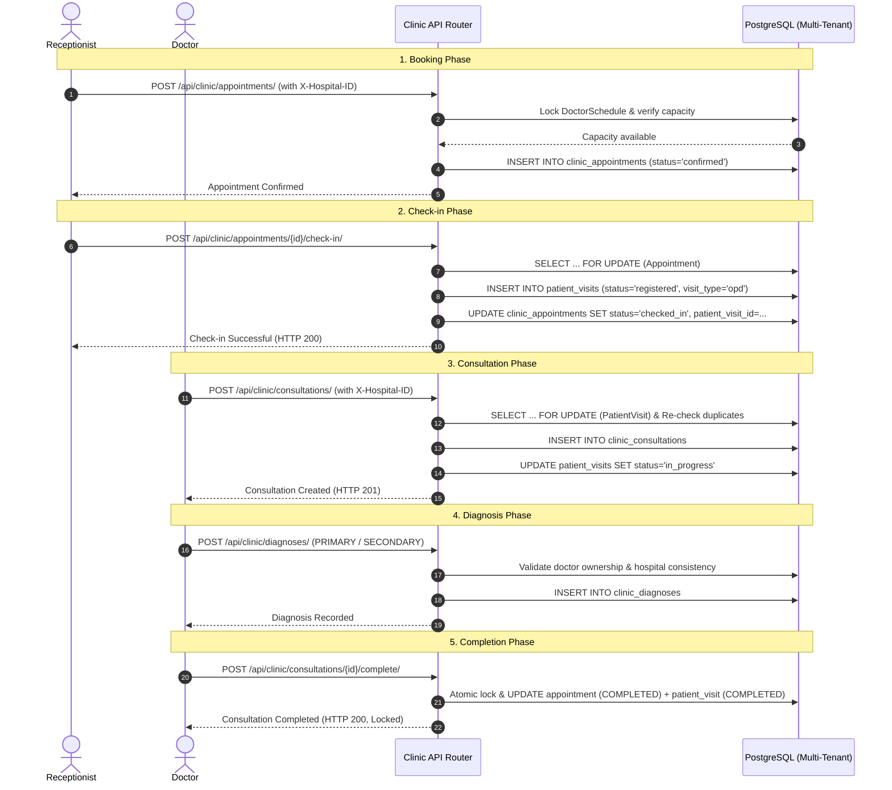

# Clinic (OPD) Department — Development Progress Report

**Project:** HMS_Software_Mechanics_M10  
**Department:** Clinic / Outpatient Department (OPD)  
**Stack:** Django 6.1.2, Django REST Framework 3.18.3, PostgreSQL 16 (Docker), Python 3.14  
**Date:** November 28, 2026  
**Auditor:** Senior Software Engineer, Technical Documentation Specialist, and Project Auditor  

---

## Executive Summary

The **Clinic (OPD) Department** in `apps/clinic` provides multi-hospital outpatient scheduling, capacity tracking, appointment reservations, patient check-in workflows, clinical consultations, and diagnostic recording. All core OPD milestones—from doctor scheduling to consultation completion—have been developed, hardened for multi-tenant isolation, protected against concurrency and race conditions, and fully validated with 58 automated tests passing (100% pass rate).

---

## A. Project Overview

### 1. Purpose
The Clinic Department manages the clinical outpatient encounters of patients across multiple hospital branches. It acts as the operational bridge connecting patient admissions, doctor schedules, clinical encounters, diagnostic evaluations, and subsequent treatment or follow-ups.

### 2. Role within the Hospital Management System (HMS)
Within the multi-tenant HMS architecture:
- **`apps.hospitals`**: Defines the tenant boundary (`Hospital`). All clinical interactions are strictly scoped to the active hospital.
- **`apps.core`**: Manages custom authentication (`core.User`) and employee memberships (`core.Employee` with role assignments like `DOCTOR`, `RECEPTIONIST`, `HOSPITAL_ADMIN`, `NURSE`).
- **`apps.doctors`**: Defines doctor professional profiles (`doctors.Doctor`) linked to `core.Employee`.
- **`apps.patients`**: Manages patient demographic masters (`patients.Patient`) and hospital attendance records (`patients.PatientVisit`).
- **`apps.clinic`**: Executes the clinical care pipeline, driving doctor scheduling, appointment management, patient check-in, doctor consultations, and diagnoses.

### 3. Core OPD Lifecycle
```
[Doctor Schedule Configured]
           │
           ▼
[Appointment Booked (Status: PENDING / CONFIRMED)]
           │
           ▼
[Patient Check-in at Reception] ──► [PatientVisit Created (OPD, Status: REGISTERED)]
           │
           ▼
[Appointment Status: CHECKED_IN]
           │
           ▼
[Doctor Starts Consultation] ──► [PatientVisit Status: IN_PROGRESS]
           │
           ├──► [Clinical Notes, Complaints & Advice Recorded]
           ├──► [Diagnoses Added (PRIMARY, SECONDARY, DIFFERENTIAL)]
           │
           ▼
[Consultation Completed] ──► [Appointment Status: COMPLETED]
                         ──► [PatientVisit Status: COMPLETED]
                         ──► [Clinical Notes & Diagnoses Locked]
```

---

## B. Implemented Modules & Capabilities

### 1. Doctor Schedule Management
- **Purpose:** Configures weekly outpatient working hours and capacity for active doctors.
- **Models:** `DoctorSchedule` (table: `clinic_doctor_schedules`).
- **Key Fields:** `hospital`, `doctor`, `weekday` (0–6), `start_time`, `end_time`, `slot_minutes` (15, 30, 45), `max_patients` (>=1), `valid_from`, `valid_to`, `is_available`.
- **Business Logic:**
  - Enforces `end_time > start_time`.
  - Enforces `valid_to >= valid_from`.
  - Validates that doctor belongs to the target hospital and has status `ACTIVE`.
  - Prevents overlapping schedule intervals for the same doctor on the same weekday across active date ranges.
- **API Endpoint:** `/api/clinic/schedules/` (GET, POST, PUT, PATCH, DELETE).

### 2. Doctor Availability Engine
- **Purpose:** Dynamically computes available consultation time slots for a doctor on any given date.
- **Logic:**
  - Resolves active `DoctorSchedule` matching the requested weekday and date.
  - Queries active bookings (`PENDING`, `CONFIRMED`, `CHECKED_IN`).
  - Calculates remaining slot capacity (`max_patients - existing_bookings_count`).
  - Returns display times and remaining capacities.
- **API Endpoint:** `GET /api/clinic/doctors/{doctor_id}/available-slots/?date=YYYY-MM-DD`.

### 3. Appointment Booking & Management
- **Purpose:** Manages patient appointment booking, rescheduling, and status transitions.
- **Models:** `Appointment` (table: `clinic_appointments`).
- **Key Fields:** `hospital`, `patient`, `doctor`, `patient_visit`, `appointment_date`, `appointment_time`, `status`, `booking_source`, `reason`, `cancellation_reason`.
- **Status State Machine:**
  - `PENDING` ➔ `CONFIRMED`, `CANCELLED`, `NO_SHOW`
  - `CONFIRMED` ➔ `CHECKED_IN`, `CANCELLED`, `NO_SHOW`
  - `CHECKED_IN` ➔ `COMPLETED`, `CANCELLED`
  - `COMPLETED`, `CANCELLED`, `NO_SHOW`: Terminal states.
- **Concurrency & Double-Booking Protection:**
  - Acquires database-level locks via `select_for_update()` in a `transaction.atomic()` block during booking or rescheduling.
  - Ensures active bookings do not exceed `schedule.max_patients`.
- **API Endpoint:** `/api/clinic/appointments/` (GET, POST, PUT, PATCH, DELETE).

### 4. Patient Check-in
- **Purpose:** Automates the transition of confirmed appointments into active OPD visits upon patient arrival at the clinic.
- **Workflow & Rules:**
  - Restricted to `receptionist`, `hospital_admin`, and `superuser`.
  - Enforces that appointment status is `CONFIRMED`.
  - Atomically locks appointment row via `select_for_update()`.
  - Creates a new `PatientVisit` with `visit_type=OPD` and `status=REGISTERED`.
  - Links `appointment.patient_visit` and updates appointment status to `CHECKED_IN`.
  - **Idempotency:** Repeated requests for an already checked-in appointment safely return HTTP 200 with `"detail": "Already checked in."` and existing data without creating duplicate visits.
- **API Endpoint:** `POST /api/clinic/appointments/{id}/check-in/`.

### 5. PatientVisit Integration
- **Purpose:** Seamlessly links clinical appointments to the hospital's central patient visit tracking system (`apps/patients/models.py:PatientVisit`).
- **Attributes:** Validates hospital consistency (`patient_visit.hospital_id == appointment.hospital_id`) and patient identity (`patient_visit.patient_id == appointment.patient_id`).

### 6. Consultation Management
- **Purpose:** Facilitates doctor documentation of clinical findings, examinations, and advice.
- **Models:** `Consultation` (table: `clinic_consultations`).
- **Key Fields:** `hospital`, `patient_visit`, `doctor`, `appointment`, `complaints`, `examination_notes`, `advice`, `follow_up_date`.
- **Business Logic:**
  - Creation restricted to active Doctors assigned to their own profile.
  - Initiation automatically moves `PatientVisit.status` from `REGISTERED` to `IN_PROGRESS`.
  - Concurrency protected: locks `PatientVisit` with `select_for_update()` inside `transaction.atomic()`, preventing racing duplicate consultations.
  - Supports walk-in encounters where `appointment` is `None`.
- **API Endpoint:** `/api/clinic/consultations/` (GET, POST, PUT, PATCH, DELETE).

### 7. Diagnosis Management
- **Purpose:** Records clinical diagnostic evaluations linked to active consultations.
- **Models:** `Diagnosis` (table: `clinic_diagnoses`).
- **Key Fields:** `hospital`, `consultation`, `diagnosis_name`, `icd_code`, `diagnosis_type`, `notes`.
- **Diagnosis Types:** `PRIMARY`, `SECONDARY`, `DIFFERENTIAL`.
- **Security & Immutability:**
  - Doctors can only manage diagnoses for their own consultations.
  - **Re-parenting Prevention:** Rejects changes to `consultation` or `hospital` fields on update.
  - **Completed Lock:** Rejects creation, modification, or deletion if parent consultation is completed.
- **API Endpoint:** `/api/clinic/diagnoses/` (GET, POST, PUT, PATCH, DELETE).

### 8. Consultation Completion Action
- **Purpose:** Finalizes outpatient care documentation and releases the patient.
- **Execution:**
  - Invoked via `POST /api/clinic/consultations/{id}/complete/`.
  - Atomically locks consultation, appointment, and visit.
  - Advances `Appointment.status` to `COMPLETED`.
  - Advances `PatientVisit.status` to `COMPLETED`.
  - Locks all clinical notes and diagnoses against subsequent edits or deletion.

---

## C. System Workflow & Data Flow



### Walk-in Consultations Support
For unscheduled/walk-in patients:
1. Patient directly checks in at OPD (`PatientVisit` created without an `Appointment`).
2. Doctor creates consultation referencing `patient_visit` with `appointment=None`.
3. Completion cleanly advances `PatientVisit` to `COMPLETED` and locks clinical notes.

---

## D. Technical Implementation

### 1. Architectural Stack & URL Routing
The Clinic Department mounts under the global API router (`hms/urls.py` line 23):
```text
Global URL Prefix: /api/
Clinic Routes:
  - /api/clinic/schedules/
  - /api/clinic/appointments/
  - /api/clinic/appointments/{id}/check-in/
  - /api/clinic/doctors/{doctor_id}/available-slots/
  - /api/clinic/consultations/
  - /api/clinic/consultations/{id}/complete/
  - /api/clinic/diagnoses/
```

### 2. Data Normalization
- Demographics (`patient_name`, `patient_dob`, `patient_gender`, `patient_number`) are dynamically resolved from `PatientVisit.patient` using read-only serializer methods.
- Zero duplicated patient or doctor columns exist on `Consultation` or `Diagnosis`.

### 3. Transaction Management & Concurrency
- `transaction.atomic()` context managers encapsulate all state transitions.
- PostgreSQL `select_for_update()` row locks prevent:
  - Double booking beyond schedule capacity.
  - Race conditions during simultaneous check-in attempts.
  - Concurrent duplicate consultation creation for the same patient visit.

---

## E. Security Implementation

| Security Control | Implementation Detail |
|---|---|
| **Tenant Isolation** | Evaluated via `BaseHospitalScopedPermission` and `get_hospital_id_from_request`. Verifies `X-Hospital-ID` against active `core.Employee` hospital membership. Mismatched or spoofed headers return `403 Forbidden` or `404 Not Found`. |
| **Doctor Ownership** | In `ConsultationViewSet` and `DiagnosisViewSet`, doctors are restricted in `get_queryset()` to `doctor__employee__user == request.user`. Creation/update verifies that doctor matches request employee profile. |
| **Receptionist Restriction** | Receptionists are explicitly barred from viewing or editing consultations and diagnoses (`403 PermissionDenied("Reception staff cannot access...")`). |
| **Clinical Oversight** | Hospital Admins and Nurses are granted read-only visibility for clinical oversight and continuity of care, but cannot author clinical notes or diagnoses. |
| **Superuser Context** | Superusers retain administrative access but are scoped to the selected hospital context when provided. |
| **Diagnosis Re-parenting Prevention** | `DiagnosisSerializer.validate()` rejects changing `consultation` or `hospital` fields on existing records. |
| **Completed Immutability** | `Consultation.is_completed` property locks clinical notes and blocks adding, editing, or deleting diagnoses on finished encounters. |

---

## F. Automated Testing

All tests were executed against PostgreSQL inside the project virtual environment (`./.venv`):
```bash
./.venv/bin/python manage.py test apps.clinic
```

### Test Results Summary:
- **Total Tests:** 58
- **Passed:** 58 (100%)
- **Failed:** 0
- **Errors:** 0
- **Execution Time:** ~7.5 seconds

### Test Suite Breakdown:

| Test Module | Test Count | Key Features & Rules Tested |
|---|---|---|
| `apps/clinic/tests.py` | 11 | Permission foundation, role boundaries (`IsHospitalAdmin`, `IsDoctor`, `IsNurse`, `IsReceptionist`, `IsClinicStaff`), hospital context resolution, suspended employee rejection. |
| `apps/clinic/test_phase2.py` | 13 | Doctor schedule CRUD, capacity validation, working hour overlap rejection, available slots generation, appointment booking, doctor visibility scoping, cancellation reasons. |
| `apps/clinic/test_admin_security.py` | 12 | Django Admin multi-tenant isolation, cross-hospital autocomplete leakage prevention, foreign key scoping, form tampering protection. |
| `apps/clinic/test_checkin.py` | 10 | Patient check-in workflow, `PatientVisit` creation, appointment status transition, check-in idempotency, unauthorized role rejection, cross-hospital rejection, transaction rollback, concurrency protection. |
| `apps/clinic/test_consultation.py` | 12 | Doctor consultation creation, patient demographic serialization, doctor ownership enforcement, receptionist access rejection, cross-hospital isolation, diagnosis types (`PRIMARY`, `SECONDARY`, `DIFFERENTIAL`), diagnosis re-parenting prevention, completed consultation immutability, diagnosis deletion protection, walk-in consultations, concurrent duplicate creation prevention under lock. |

---

## G. Pending Development

Features remaining for upcoming development phases:

1. **Prescription Management API:**
   - Serializers and ViewSets for `Prescription` and `PrescriptionItem` models (already defined in `apps/clinic/models.py`).
   - Digital prescription generation linked to completed consultations.
2. **Pharmacy Department Integration:**
   - Linking `PrescriptionItem.medicine_id` to `apps.pharmacy.Medicine`.
   - Real-time stock reservation and dispensing workflow.
3. **Billing & Accounting Integration:**
   - Invoicing consultation fees (`Doctor.consultation_fee`) and diagnostic charges in `apps.accounting`.
4. **Clinic Frontend UI Integration:**
   - Integration with React/Next.js/Blade/Django templates for OPD doctor queues and receptionist booking interfaces.
5. **End-to-End System Testing:**
   - Full integration testing connecting `apps.patients`, `apps.clinic`, `apps.diagnostic`, and `apps.pharmacy`.

---

## H. Final Project Status

- **Completed Milestones:**
  - ✅ Milestone 1: Multi-tenant Django Admin & Security Hardening.
  - ✅ Milestone 2: Doctor Schedule Engine & Slot Availability Calculator.
  - ✅ Milestone 3: Appointment Booking Engine with Concurrency Slot Protection.
  - ✅ Milestone 4: Patient Check-in & `PatientVisit` Automated Integration.
  - ✅ Milestone 5: Consultation Management, Clinical Documentation & Diagnostic Workflows.
  - ✅ Milestone 6: Concurrency, Re-parenting & Immutability Security Hardening.
- **Current Technical Status:** All core outpatient workflow APIs are fully operational, tenant-isolated, documented, and covered by automated tests.
- **Recommended Next Phase:** Implement the **Prescription & PrescriptionItem API** to complete the clinical documentation pipeline before initiating Pharmacy dispensing integration.
